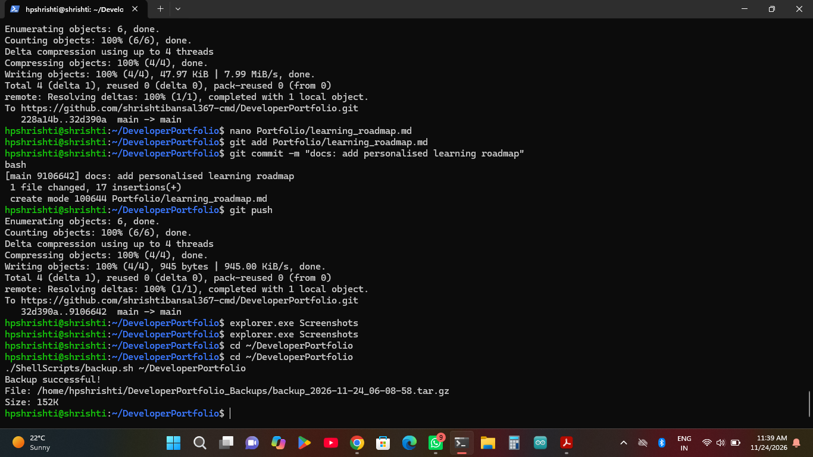
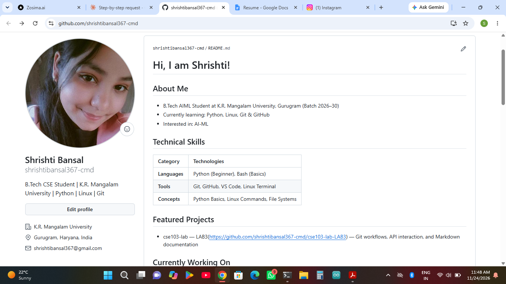
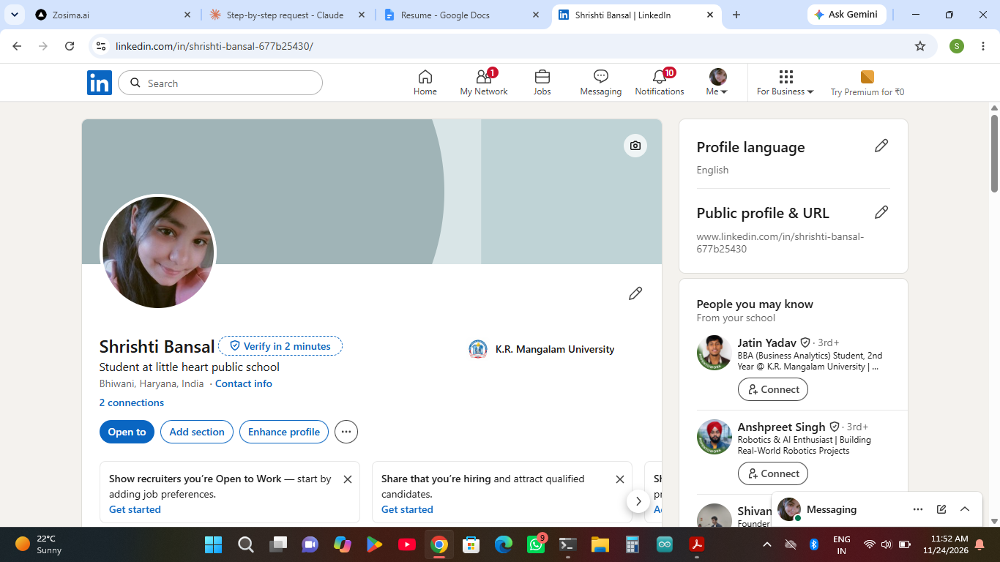

# DeveloperPortfolio

Beginner Developer Ecosystem Portfolio by Shrishti bansal (Roll No: 2601730321), K.R Mangalam University, Batch 2026–2030.

🌐 Live site: https://shrishtibansal367-cmd.github.io/DeveloperPortfolio

## Sections
| Folder | Question | Contents |
|--------|----------|----------|
| [Linux/](Linux/) | Q1 – CO1 | System profile, binary conversion, command outputs |
| [ShellScripts/](ShellScripts/) | Q2 – CO2 | `sysinfo.sh`, `backup.sh` |
| [API/](API/) | Q3 – CO3 | GitHub & JSONPlaceholder API data, API summary |
| [Portfolio/](Portfolio/) | Q4 – CO4 | Resume, learning roadmap |

## Screenshots

## Connect
- GitHub: https://github.com/<username>
- LinkedIn: https://www.linkedin.com/in/<your-linkedin-id># DeveloperPortfolio
Beginner Developer Ecosystem Portfolio
